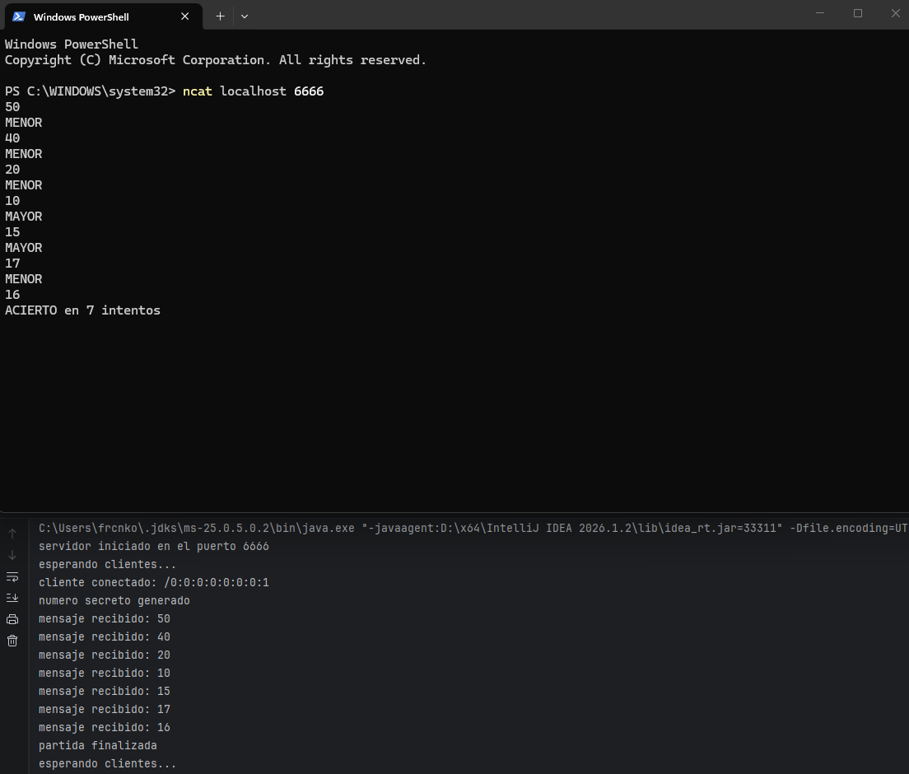
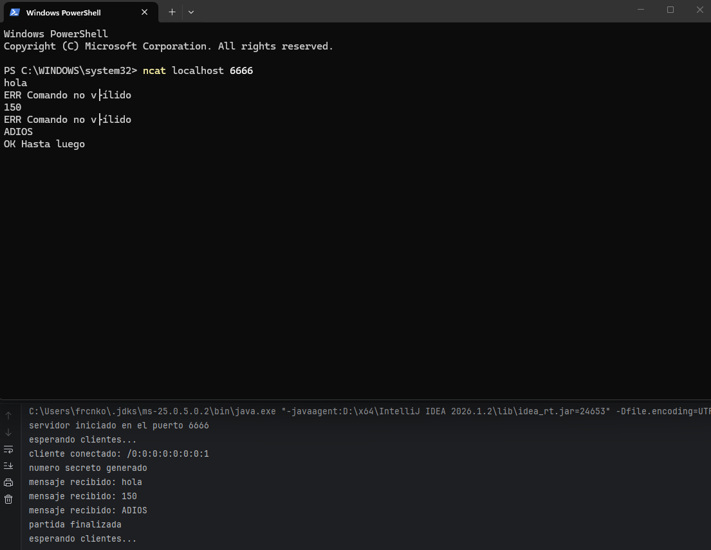
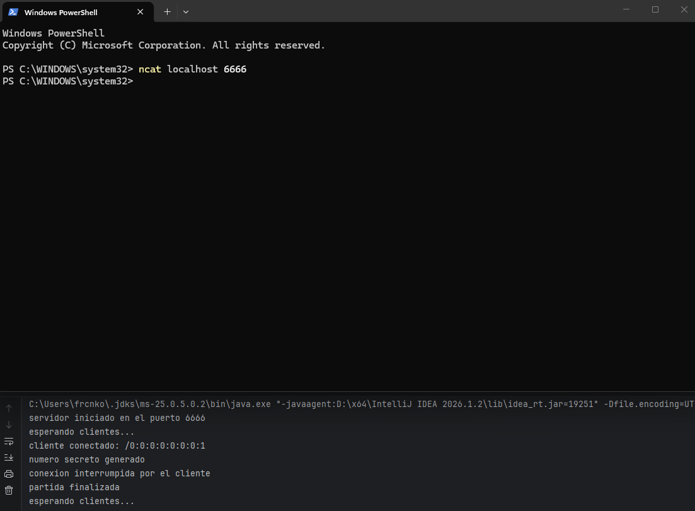

# Tarea 28 - Adivina el número
Franco Naraza

## Descripción

El programa consiste en un juego en el que el servidor genera
un número aleatorio entre 1 y 100 y el cliente debe intentar
adivinarlo introduciendo números por teclado.

La comunicación entre el cliente y el servidor se realiza
mediante el protocolo TCP.

## Estructura del proyecto

- cliente.java: establece la conexión con el servidor,
  solicita los números al usuario y muestra las respuestas.
- servidor.java: genera el número secreto, comprueba los
  intentos y responde al cliente.

## Configuración

- Protocolo: TCP.
- Dirección: localhost.
- Puerto: 6666.
- Codificación: UTF-8.
- Rango de números: del 1 al 100.

## Protocolo de comunicación

El cliente y el servidor intercambian mensajes de texto
separados por saltos de línea.

Cada línea enviada por el cliente recibe una única respuesta
del servidor.

| Mensaje del cliente | Respuesta del servidor |
| --- | --- |
| Número inferior al secreto | MAYOR |
| Número superior al secreto | MENOR |
| Número correcto | ACIERTO en N intentos |
| ADIOS | OK Hasta luego |
| Comando incorrecto | ERR Comando no válido |

Los números fuera del rango permitido también reciben
el mensaje ERR Comando no válido.

Los comandos incorrectos no se contabilizan como intentos.

## Funcionamiento

1. Se ejecuta el servidor.
2. El cliente establece una conexión TCP.
3. El servidor genera un número aleatorio entre 1 y 100.
4. El cliente introduce un número por teclado.
5. El servidor compara el número recibido con el secreto.
6. El servidor responde indicando si el número es mayor,
   menor o correcto.
7. La partida continúa hasta que el cliente acierta,
   escribe ADIOS o cierra la conexión.

El servidor permanece activo después de finalizar una
partida, permitiendo que se conecten nuevos clientes.

Cada cliente tiene un número secreto y un contador de
intentos independientes.

## Control de errores

Se utiliza NumberFormatException para controlar los mensajes
que no pueden convertirse en números enteros.

También se comprueba que los números introducidos estén
comprendidos entre 1 y 100.

Las desconexiones se controlan mediante readLine(),
SocketException e IOException, evitando mostrar trazas
de excepciones cuando el cliente cierra la conexión.

Los recursos se cierran mediante try-with-resources.

## Partida jugada con nc

Para comprobar el funcionamiento del servidor se ha utilizado
Ncat, una implementación de Netcat disponible en Windows.

Con el servidor iniciado, se ejecuta el siguiente comando
desde PowerShell:

```powershell
ncat localhost 6666
```

Resultado de la partida:



## Pruebas adicionales

### Comandos incorrectos

Se comprueba que el servidor responde con ERR Comando no válido
cuando se introduce texto, una línea vacía o un número fuera
del rango permitido.

### Comando ADIOS

Al introducir ADIOS, el servidor responde:

```text
OK Hasta luego
```

Después se cierra la conexión.



### Desconexión inesperada

Se comprueba el cierre de la conexión pulsando Ctrl+C
desde Ncat.

El servidor debe gestionar la desconexión sin mostrar
ninguna traza de excepción y continuar esperando clientes.




## Declaración del uso de la IA

>Para realizar esta tarea, he utilizado la inteligencia
artificial como herramienta de apoyo (Claude).

El prompt fue:
> Estoy realizando una práctica de comunicación TCP en Java y el profesor me pide realizar una partida utilizando el comando nc. Sin embargo, utilizo Windows y no dispongo de este comando. ¿Qué alternativa puedo utilizar, cómo puedo instalarla y cómo puedo conectarme a mi servidor desde la terminal de IntelliJ?

Me recomendó utilizar Ncat, me explicó cómo instalarlo
mediante winget y cómo utilizarlo desde la terminal para
conectarme al servidor, jugar una partida y comprobar
el funcionamiento de las desconexiones mediante Ctrl+C.